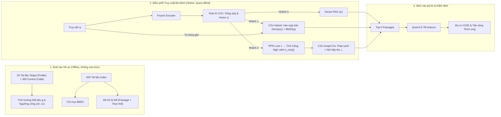

# KẾ HOẠCH NGHIÊN CỨU & TRIỂN KHAI: MỞ RỘNG C2U CHO HYBRID RAG VÀ GRAPH RAG

> **Tài liệu báo cáo Giảng viên Hướng dẫn**  
> Tổng hợp đầy đủ từ 6 giai đoạn triển khai, lược bỏ chi tiết cài đặt mã nguồn/môi trường thủ công, tập trung vào **cơ sở khoa học**, **kiến trúc hệ thống**, **các công thức cốt lõi**, **thiết kế thực nghiệm chống rò rỉ**, và **lộ trình chạy trên Kaggle Notebook**.

---

## 1. Bối cảnh, Vấn đề & Đóng góp của Đề tài

### 1.1. Bài toán đặt ra
Trong các hệ thống **RAG (Retrieval-Augmented Generation)**, việc loại bỏ hoặc ngăn chặn rò rỉ một nhóm tri thức nhạy cảm (*Target Concept*) thường đòi hỏi phải huấn luyện lại mô hình nhúng (*encoder*) hoặc xóa/đánh chỉ mục lại toàn bộ cơ sở dữ liệu. Phương pháp **C2U (*Concept-to-Unit*)** giải quyết bài toán này ở tầng truy vấn: đặt một toán tử hiệu chỉnh trực tuyến giữa Encoder đóng băng và bộ truy xuất, giúp lái vector truy vấn $q$ ra xa khái niệm cấm mà **không sửa encoder, không sửa kho dữ liệu, và mù hoàn toàn với vai trò truy vấn (*query-blind*)**.

### 1.2. Khoảng trống từ bài báo gốc
Bài báo **C2U in RAG** chứng minh C2U đạt hiệu quả ức chế một phần trên **Dense RAG** (giảm trung bình Hit@5 mục tiêu từ ~94.7% xuống ~90.5%, tức giảm ~4.25–4.67 điểm phần trăm tùy bộ dữ liệu), nhưng bản thân bài báo cũng chỉ ra những giới hạn lớn khi đưa vào hệ thống thực tế:
1. **Lỗ hổng từ khóa trên Hybrid RAG (Dense + BM25):** Ngay cả khi vector $q'$ đã né được khái niệm cấm trên nhánh Dense, nhánh **BM25** vẫn khớp từ khóa trực tiếp từ văn bản truy vấn gốc $q$ và kéo tài liệu nhạy cảm quay lại Top-$K$.
2. **Lỗ hổng lan truyền đa bước trên Graph RAG (Knowledge Graph + PPR):** Với các câu hỏi bắc cầu 2-hop chỉ nhắc đến thực thể an toàn ($v_{\text{ctrl}} \to v_{\text{mid}} \to v_{\text{target}}$), truy vấn gốc không chứa dấu hiệu cấm nên cổng C2U gần như không kích hoạt, để mặc thuật toán Personalized PageRank (PPR) lan truyền tới tài liệu mục tiêu.
3. **Chưa kiểm định tầng sinh LLM và kẻ tấn công thích ứng:** Bài báo gốc mới đo ở tầng truy xuất (*retrieval*), chưa đánh giá mức độ lộ thông tin ở câu trả lời cuối cùng của LLM và chưa thử nghiệm với kẻ tấn công biết cơ chế phòng thủ (*defense-aware*).
4. **Tính độc lập của tập Test:** Bài báo gốc mở rộng một số thử nghiệm theo hướng *post-hoc* nên chưa có khẳng định chặt chẽ trên một tập *untouched test*.

### 1.3. Mục tiêu của Đề tài
1. **Tái lập trung thực** C2U trên Dense RAG làm mốc tham chiếu (trên 4 bộ dữ liệu $\times$ 4 encoder $\times$ 3 seed = 48 đơn vị đánh giá).
2. **Đề xuất hai mở rộng kiến trúc mới:** `C2U-Hybrid` (van điều tiết động Dense/BM25) và `C2U-Graph-Ctx` (phạt cạnh đồ thị dựa trên cổng ngữ cảnh + nút hấp thụ).
3. **Đánh giá toàn diện trên tập Test khóa một lần (*Untouched Test*):** đo lường cả tầng truy xuất, tầng đầu ra LLM (*End-to-End*), tấn công thích ứng nhiều lượt và độ bền khi hồ sơ khái niệm bị thiếu/nhiễu.

---

## 2. Các Bài báo & Phương pháp Nền tảng

| Nhóm | Bài báo / Phương pháp | Vai trò & Cách sử dụng trong Đề tài |
| :--- | :--- | :--- |
| **Bài báo trung tâm** | **C2U in RAG** (*Concept-to-Unit Machine Unlearning*) | Nền tảng chính: cung cấp kiến trúc từ điển nguyên tử (ACR), cổng hiệu chuẩn $s(q)$, toán tử chỉnh sửa truy vấn vùng tin cậy, và giao thức chia tách dữ liệu rời rạc. |
| **Xóa khái niệm biểu diễn** | **INLP** (*Ravfogel et al., 2020*) & **LEACE** (*Belrose et al., 2023*) | Hai phương pháp đối chứng chuẩn mực về xóa khái niệm tuyến tính trên không gian vector (yêu cầu thêm 400 mẫu calibration có nhãn). |
| **Baseline RAG Unlearning** | **Delta-Edit**, **PISCES**, **DARE-GRL**, **RAG-Emb-Ctrl**, **CURE** | Các phương pháp đối chứng cùng hạng hoặc có thêm nhãn calibration trong bài báo gốc để định vị hiệu quả của C2U. |
| **Cận trên có quyền kho** | **Filter-and-Refill**, **Rank-Router**, **Graph-Node-Deletion** | Các phương pháp có quyền biết danh sách tài liệu cấm (*membership oracle*), dùng làm cận trên để đo khoảng cách giữa giải pháp *query-blind* và lọc trực tiếp. |
| **Tấn công đối kháng** | **Zou et al. (2023)** (*Adversarial Suffix / Zou-noise*) | Tạo hậu tố nhiễu đối kháng và chèn chỉ thị (*Prompt Injection*) để kiểm tra độ bền của hệ thống trước biến đổi truy vấn. |
| **Truy xuất Lai & Đồ thị** | **BM25Okapi**, **RRF** & **Personalized PageRank (PPR)** | Nền tảng cho hai nhánh mở rộng: trộn điểm Dense–Sparse (Hybrid) và lan truyền trên đồ thị dị thể Passage–Entity (Graph RAG). |

---

## 3. Kiến trúc Hệ thống Đề xuất

### 3.1. Sơ đồ Tổng thể
Hệ thống tách bạch rõ ràng giữa **pha chuẩn bị hồ sơ ngoại tuyến (Offline)** và **pha điều phối truy xuất trực tuyến (Online)**, đảm bảo mọi nhánh (Dense, Hybrid, Graph) đều dùng chung một bộ mã hóa đóng băng và không sửa đổi kho dữ liệu gốc.

### 3.2. Vai trò thực tế của Từ điển ACR (Lưu ý Phương pháp luận)
Trong bài báo gốc, từ điển nguyên tử $A \in \mathbb{R}^{N \times d}$ được huấn luyện trước bằng 3 hàm mất mát (Triplet, Alignment, Entropy). Tuy nhiên, về mặt đại số tại điểm vận hành chuẩn ($\beta = 1$), phép chiếu cộng phần dư của C2U khôi phục lại gần như chính xác toàn bộ hướng triệt tiêu $g$.
- **Cách xử lý của đề tài:** Vẫn huấn luyện ACR đúng chuẩn bài báo để tái lập trung thực (kèm thực nghiệm *ablation* so sánh **ACR đã huấn luyện**, **ACR chưa huấn luyện**, và **công thức dạng đóng**). Đồng thời, khẳng định minh bạch rằng **hai đóng góp mới (`C2U-Hybrid` và `C2U-Graph-Ctx`) chỉ dựa vào $q'$, cổng $s(q)$, hướng $g$ và tâm $\mu_t$**, không phụ thuộc vào việc tinh chỉnh ACR.

### 3.3. Ba Công thức Cốt lõi Quyết định Cơ chế

#### (1) Toán tử Hiệu chỉnh Truy vấn trong Vùng Tin cậy (`Dense-C2U`)
$$q' = \text{normalize}(q + \eta\, \delta_q), \quad \text{sao cho } \langle q', q \rangle \ge 0.98 \text{ (tức góc xoay } \theta \le 0.2\text{ rad)}$$
- **Cơ chế dễ hiểu:** Hệ thống tính điểm chiếu $z(q)$ của truy vấn lên cặp tâm $(\mu_t, \mu_c)$ và đi qua **cổng liên tục $s(q) \in [0, 1]$**.
  - Nếu $s(q) = 0$ (truy vấn an toàn): giữ nguyên vector gốc $q$ hoàn toàn (*gate-off identity*), không làm méo truy vấn thường.
  - Nếu $s(q) > 0$: đẩy $q$ theo hướng triệt tiêu $g$ một góc tối đa $0.2\text{ rad}$ (được kiểm soát bằng hệ số $\eta \in (0, 1]$) để giữ nguyên ngữ nghĩa hợp lệ.

#### (2) Van Điều tiết Trọng số Động (`C2U-Hybrid`)
$$\text{Score}(q,d) = \alpha(q)\,\tilde{S}_{\text{dense}}(q', d) + \big(1 - \alpha(q)\big)\,\tilde{S}_{\text{BM25}}(q, d), \quad \text{với } \alpha(q) = \alpha_{\text{base}} + (1 - \alpha_{\text{base}})\,s(q)^\gamma$$
- **Giải thích:** $\tilde{S}_{\text{dense}}$ và $\tilde{S}_{\text{BM25}}$ là điểm Dense và BM25 được chuẩn hóa min-max trên tập ứng viên hợp nhất ($\text{Top-}50_{\text{Dense}}(q') \cup \text{Top-}50_{\text{BM25}}(q)$), với $\alpha_{\text{base}} = 0.5$ và siêu tham số $\gamma \ge 1$.
- **Tại sao hiệu quả:** Khi truy vấn chạm ngưỡng khái niệm cấm ($s(q)$ tăng), van $\alpha(q)$ tiến về $1$, tự động **khép kênh BM25** để ngăn từ khóa thô kéo tài liệu cấm quay lại Top-5. Với truy vấn thường ($s(q)$ nhỏ hoặc bằng $0$), hệ số mũ $\gamma$ giúp giữ van mở gần mức $50/50$ để bảo toàn độ chính xác tìm kiếm từ khóa.

#### (3) Phạt Cạnh Theo Ngữ cảnh & Nút Hấp thụ (`C2U-Graph-Ctx`)
$$w_{\text{eff}}(u \to v) = w_{\text{base}}(u \to v)\cdot \exp\big(-\lambda_{\text{graph}}\, s_{\text{eff}}(q)\, \rho(v)\big), \quad s_{\text{eff}}(q) = \max\big(s(q),\, s_{\text{ctx}}(q)\big)$$
- **Giải thích hai cải tiến then chốt so với Graph RAG thông thường:**
  1. **Cổng ngữ cảnh $s_{\text{ctx}}(q)$:** Truy vấn 2-hop chỉ nhắc thực thể an toàn nên $s(q) \approx 0$. Hệ thống chạy **PPR lượt 1** với trọng số gốc, lấy tổ hợp embedding của Top-$k$ passage thu được làm ngữ cảnh $c(q)$ rồi đo cổng $s_{\text{ctx}}(q) = \text{gate}(c(q))$. Nếu vùng ngữ cảnh đang trôi về phía khái niệm cấm, $s_{\text{eff}}(q)$ lập tức bật lên.
  2. **Nút hấp thụ $\perp$:** Ở lượt PPR thứ 2, trọng số cạnh đi vào nút nhạy cảm $\rho(v)$ bị giảm theo $\lambda_{\text{graph}}$. Toàn bộ phần trọng số bị cắt $(w_{\text{base}} - w_{\text{eff}})$ được **dồn vào một nút hấp thụ $\perp$** (không bao giờ được xếp hạng) thay vì để PageRank tự chuẩn hóa lại trọng số hàng — giúp việc phạt cạnh thực sự phát huy tác dụng ngay cả ở các nút có ít cạnh ra.

---

## 4. Thiết kế Dữ liệu & Hạ tầng Thực nghiệm

### 4.1. Phạm vi 4 Bộ dữ liệu & 4 Encoders
- **Quy mô tổng thể:** **4 dataset $\times$ 3 seed $\times$ 4 encoder = 48 units** (cộng thêm **12 units** cho bài toán đa khái niệm ArXiv $K=4$).
- **4 Encoders đóng băng:** `all-MiniLM-L6-v2` ($d=384$), `bge-base-en-v1.5` ($d=768$), `e5-base-v2` ($d=768$), `Qwen3-Embedding-0.6B` ($d=1024$).

| Bộ dữ liệu | Truy vấn (*Query*) | Tài liệu (*Document*) | Khái niệm Mục tiêu (*Target*) | Thuộc tính Kiểm soát (*Control*) |
| :--- | :--- | :--- | :--- | :--- |
| **TOFU** | Câu hỏi gốc | Hồ sơ tiểu sử tác giả | Chủ đề (*Family / Location / Work*) | Author ID |
| **Amazon** | Tiêu đề đánh giá | Nội dung đánh giá | Cảm xúc (*Positive*) | Danh mục sản phẩm |
| **MNLI** | Hypothesis | Premise | Thể loại (*Target genre*, vd: *fiction*) | Nhãn suy luận (0/1/2) |
| **ArXiv** | 50% Title / 50% câu đầu Abstract | `Title + ". " + Abstract` | *System Attacks* (`cs.CR`) + Đa khái niệm $K=4$ | Danh mục chính (*relaxed control*) |

*(Loại bỏ IMDB theo đúng nhận định của bài báo gốc vì mỗi vai trò truy vấn chỉ có một mẫu câu duy nhất).*

### 4.2. Giao thức Chia tách Chống rò rỉ (*Zero-Leakage*)
Mỗi unit được chia tách **rời rạc tuyệt đối** (kiểm tra trùng lặp theo cả ID lẫn nội dung văn bản chuẩn hóa):
- `train_acr` (1.500–2.000 cặp): dùng riêng để huấn luyện từ điển ACR; mẫu âm $d^-$ chỉ lấy trong rổ này, tuyệt đối không lấy từ kho chỉ mục.
- `target_profile` (**20** tài liệu): dùng tính hướng $g$ và tâm $\mu_t$.
- `calibration` (**300** control không nhãn cho C2U; mở rộng thành **400** có nhãn cho các baseline như INLP/LEACE).
- `index_corpus` (**400** tài liệu = 100 Target + 300 Control): kho tìm kiếm cố định dùng chung cho mọi phương pháp.
- **3 tập truy vấn độc lập** (mỗi tập **100 Target + 300 Control**):
  - `val_queries` (**Selection**): dùng để chọn siêu tham số ($\gamma$, $\lambda_{\text{graph}}$).
  - `confirm_queries` (**Confirmation**): xác nhận độc lập cấu hình đã chọn trước khi khóa.
  - `test_queries` (**Final Test**): khóa hoàn toàn, chỉ mở **đúng 1 lần** ở Chặng 4.

### 4.3. Hạ tầng Thực thi trên Kaggle Notebook
- Toàn bộ dữ liệu đã chia tách (15 thư mục split) và mã nguồn được đóng gói sẵn trong `c2u_full_bundle.zip` (~12 MB).
- Quá trình trích xuất vector đóng băng, huấn luyện ACR, dựng đồ thị tri thức và chạy thực nghiệm được thực thi trực tiếp trên **Kaggle Notebook (GPU Tesla T4 / P100)**, không cần cài đặt môi trường Python thủ công trên máy cá nhân.

---

## 5. Lộ trình Triển khai Chi tiết (4 Chặng)

### Chặng 1: Chuẩn hóa Dữ liệu & Tái lập Dense C2U (Mốc tham chiếu)
- **Mục tiêu:** Đảm bảo dữ liệu sạch không rò rỉ và tái lập được kết quả của bài báo gốc trên Dense RAG làm đường cơ sở.
- **Công việc thực hiện:**
  1. Chạy mã hóa đóng băng và kiểm tra tính toàn vẹn vector trên 48 units + 12 units ArXiv $K=4$.
  2. Chạy đánh giá `Dense-C2U` đối chứng với các baseline ưu tiên (`Raw`, `Random`, `INLP`, `LEACE`, `Delta-Edit`, `RAG-Emb-Ctrl`, `Filter-and-Refill`) trên tập `selection` và `confirmation`.
  3. **Kiểm tra biến đổi truy vấn:** Thử nghiệm 3 điều kiện (*Standard*, *Injection*, *Zou-noise*) trên 4 dataset (12 ô), kỳ vọng C2U ức chế được đủ **12/12 ô** và **0/12 ô divergent**.
  4. **Đa khái niệm (ArXiv $K=4$):** So sánh `C2U-Compose` với `Avg-Direction` trên 12 units.
  5. **Ablation về ACR:** So sánh C2U dùng ACR đã huấn luyện vs. ACR chưa huấn luyện vs. công thức dạng đóng để chứng minh vai trò thực tế của ACR.
- **Mốc tham chiếu từ bài báo (4 dataset):** Trung bình **H5 Drop ≈ +4.67 pp** (Amazon +6.33, ArXiv +5.67, MNLI +3.42, TOFU +3.25), với `CN ≤ 0` và `TE ≤ 0`. Sau khi đạt mốc, khóa cấu hình (`dense_lock.yaml`).

### Chặng 2: Xây dựng & Khóa `C2U-Hybrid` (Dense + BM25)
- **Mục tiêu:** Lấp khoảng hổng từ khóa của BM25 để kéo hiệu năng bảo vệ của Hybrid RAG về sát hoặc bằng `Dense-C2U` mà không làm giảm tiện ích truy vấn thường.
- **Công việc thực hiện:**
  1. Dựng chỉ mục `BM25Okapi` trên 400 tài liệu mỗi unit.
  2. So sánh **6 cấu hình**: `Dense-C2U` (mốc), `Hybrid-Raw`, `Naive C2U + Hybrid`, `C2U-Hybrid` (đề xuất), `C2U-Hybrid-Hard` (ablation cổng cứng $\alpha=1$ khi $s>0$), và `Hybrid + Oracle Filter` (cận trên).
  3. Quét siêu tham số $\gamma \in \{1.0, 1.5, 2.0, 3.0\}$ trên `selection`: chọn $\gamma$ cho H5 Drop cao nhất trong nhóm thỏa điều kiện `CN ≤ 0` và `TE ≤ 0`.
  4. Kiểm tra độ bền bằng *Reciprocal Rank Fusion (RRF)* và **phân tầng từ khóa trên ArXiv** (tách truy vấn có/không chứa từ khóa mục tiêu để kiểm soát thiên lệch nhãn của BM25).
- **Đầu ra:** Xác nhận trên `confirmation` và khóa cấu hình (`hybrid_lock.yaml`).

### Chặng 3: Xây dựng & Khóa `C2U-Graph-Ctx` (Graph RAG + PPR)
- **Mục tiêu:** Ngăn chặn rò rỉ đa bước (2-hop) trên đồ thị tri thức mà không xóa nút/cạnh khỏi đồ thị gốc.
- **Công việc thực hiện:**
  1. **Dựng Đồ thị Tri thức (TOFU & ArXiv):** Dùng `Qwen2.5-7B-Instruct` (4-bit AWQ) trích xuất bộ ba thực thể–quan hệ để nối vào 400 nút passage; chấm tay 50 bộ ba/dataset để kiểm định chất lượng đồ thị.
  2. **Sinh tập câu hỏi 2-hop:** Tạo `2hop_target` (50–100 câu chỉ nhắc thực thể an toàn $v_{\text{ctrl}}$, đáp án nằm ở passage target) và `2hop_control` (50–100 câu đi qua lân cận nhưng đáp án nằm ở passage control); lọc bỏ câu chứa từ khóa cấm và chấm tay 30 câu/tập.
  3. **So sánh 5 cấu hình:** `Graph-Raw`, `Naive C2U + Graph`, `C2U-Graph-QGate` (dùng cổng $s(q)$ thông thường để chứng minh lỗi không kích hoạt), `C2U-Graph-Ctx` (đề xuất), và `Graph-Node-Deletion` (xóa nút mục tiêu để kiểm chứng giả thuyết làm giảm tiện ích).
  4. Quét $\lambda_{\text{graph}} \in \{0.5, 1, 2, 4, 8\}$ trên `selection` để tối thiểu hóa tỷ lệ rò rỉ 2-hop (MPLR) với ràng buộc `Graph-CN ≤ 0`.
- **Đầu ra:** Xác nhận trên `confirmation` và khóa cấu hình (`graph_lock.yaml`).

### Chặng 4: Mở Test Một Lần, Rò rỉ Đầu ra LLM & Kẻ Tấn công Thích ứng
- **Bước 1 — Đăng ký trước (*Pre-registration*):** Chốt toàn bộ file lock, prompt (sinh, giám khảo, kẻ tấn công), hash dữ liệu test và **5 giả thuyết (H1–H5)** trước khi chạy test:
  - **H1:** Dense-C2U đạt `H5 Drop > 0`, `CN ≤ 0`, `TE ≤ 0` ở từng dataset.
  - **H2:** `C2U-Hybrid` có H5 Drop cao hơn có ý nghĩa so với `Naive C2U + Hybrid` (CI 95% không chứa 0) và `CN ≤ 0`.
  - **H3:** `C2U-Graph-Ctx` có MPLR thấp hơn `Naive C2U + Graph` với `Graph-CN ≤ 0`. *(H3b: `Graph-Node-Deletion` làm tăng `Graph-CN > 0`).*
  - **H4:** Mức giảm rò rỉ ở đầu ra LLM (*Hidden-Fact Recall*) đi cùng chiều với mức giảm truy xuất.
  - **H5:** Rò rỉ tích lũy sau 5 lượt tấn công thích ứng của `C2U-Hybrid` / `C2U-Graph-Ctx` thấp hơn `Naive C2U`.
- **Bước 2 — Test cuối một lần:** Chạy toàn bộ cấu hình đã khóa cho Dense, Hybrid, Graph và ArXiv $K=4$ trên `test_queries` (không chạy lại hay chỉnh sửa sau khi xem kết quả).
- **Bước 3 — Đánh giá End-to-End LLM Output (TOFU & ArXiv):** Cho `Qwen2.5-7B-Instruct` sinh câu trả lời từ Top-5 passages; dùng một giám khảo LLM khác họ mô hình (ví dụ Llama) để chấm tỷ lệ lộ ý ẩn (*Hidden-Fact Recall*), kèm chấm tay ngẫu nhiên 10% (đo độ đồng thuận Cohen's $\kappa$).
- **Bước 4 — Kẻ tấn công thích ứng nhiều lượt (1, 3, 5 lượt):** Một LLM độc lập đóng vai kẻ tấn công trên 100 truy vấn khó theo 2 cấp độ: (1) *Hộp đen phản hồi* (diễn đạt lại, hỏi bắc cầu) và (2) *Biết cơ chế phòng thủ* (cố tình né từ khóa để hạ cổng $s(q)$); vẽ **Query-Budget Curve**.
- **Bước 5 — Kiểm tra Độ bền Hồ sơ:** Giảm kích thước `target_profile` ($20 \to 10 \to 5$ tài liệu) và trộn 20% mẫu nhiễu control để kiểm chứng tính an toàn *fail-closed* (`CN ≤ 0`, `TE ≤ 0`).

---

## 6. Hệ thống Chỉ số Đánh giá & Thống kê

Toàn bộ kết quả được tổng hợp bằng **4.000 mẫu paired bootstrap** theo từng truy vấn để tính khoảng tin cậy **95% CI**, độ lệch chuẩn qua 3 seed, và áp dụng hiệu chỉnh **Holm** cho kiểm định đa giả thuyết H1–H5.

| Tầng đánh giá | Chỉ số Bảo vệ (Kỳ vọng) | Chỉ số Hữu dụng (Ràng buộc Utility) |
| :--- | :--- | :--- |
| **Dense & Hybrid Retrieval** | **H5 Drop** ($\uparrow$): Mức giảm tỷ lệ tài liệu target lọt Top-5. **TC** ($\uparrow$): Mức giảm độ tương đồng với tâm target. **TE** ($\downarrow \le 0$): Tỷ lệ tài liệu target lọt vào truy vấn control. **Density $\Delta$ / CER $\Delta$** ($\downarrow$): Mức giảm mật độ target trong ngữ cảnh 512 token. | **CN** ($\downarrow \le 0$): Mức mất *own-label* Hit@5 trên truy vấn control. **Own-label P@5** (phụ): Dùng khi CN bị bão hòa (như MNLI). **Attack Utility**: Mức mất Hit@10 dưới biến đổi truy vấn. |
| **Graph Retrieval (2-hop)** | **MPLR** ($\downarrow$): Tỷ lệ truy vấn `2hop_target` kéo được passage target vào Top-5. | **Graph-CN** ($\downarrow \le 0$): Mức mất Hit@5 của passage vàng trên tập `2hop_control`. |
| **LLM End-to-End Output** | **`copy20`** ($\downarrow$): Tỷ lệ câu trả lời chép nguyên văn $\ge 20$ token từ tài liệu target. **Hidden-Fact Recall** ($\downarrow$): Tỷ lệ ý ẩn bị lộ (đo tích lũy qua 1–5 lượt khi tấn công). | **Answer Recall** ($\uparrow$): Tỷ lệ ý đúng được bao phủ trên truy vấn thường (kiểm soát kèm độ dài câu trả lời). |
